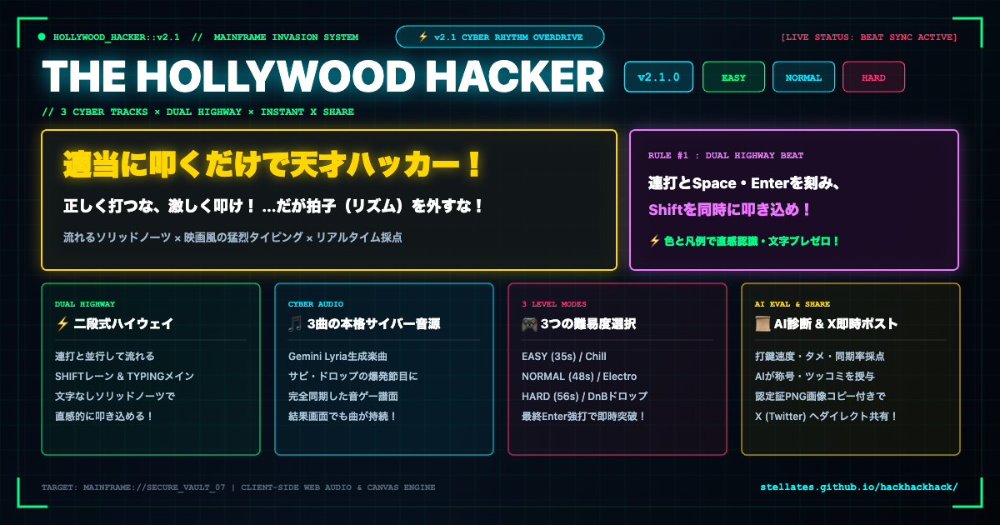

# THE HOLLYWOOD HACKER v2.1 (猛烈打鍵！ハリウッド・ハッカー)

ドラマやハリウッド映画に登場する「キーボードを猛烈な勢いで叩いて何でも解決する天才ハッカー」になりきれる、ブラウザ向けサイバーリズム・タイピングアクションです。



---

## 🎯 コンセプト

> **「正しく打つな、激しく叩け！…だが拍子（リズム）を外すな！」**

映画ハッカーの「猛烈なキーボードガチャガチャ」に加え、**音ゲー（リズムアクション）の爽快なタイミング判定と難易度選択**が融合！
v2.1 では、本格サイバー音源への対応、視認性を極限まで高めた「文字なしソリッドノーツ」、曲のサビやドロップに合わせた音楽的カットオフ、そして結果画面のX（Twitter）ダイレクト共有を実装しました。

---

## ⚡ v2.1 主なアップデート内容

1. **本格サイバー音源 & 難易度別3トラック完全同期**
   - 難易度ごとに全く異なるテンポ・ジャンルの専用サイバーミュージックを搭載（Google Gemini Lyria音源）。
   - 固定の秒数制限ではなく、各楽曲のサビやドロップの節目に合わせたゲーム長・最終Enterを配置。
   - ゲームクリア（ACCESS GRANTED）後も曲をぶつ切りにせず、音量をダッキングして結果画面でも最後まで流し続ける余韻設計。
   - ※音声ファイル未配置時やロード失敗時は自前プロシージャルシンセへ自動フォールバック。

2. **文字ブレ根絶！文字なし「ソリッド・ネオンクリスタルノーツ」**
   - 高速移動するノーツ内の文字や記号を100%全廃。
   - タイピングエリア直上の大判常時キーマップHUD（KEY MAP）と「4色（緑・黄・紫・赤）」のみで直感認識させ、動く文字を読む負荷を根絶。
   - サブピクセル補間ブレを排除した整数pxレンダリングにより、残像のない鮮明なビジュアルを実現。

3. **二段式サイバー・ハイウェイ（Dual Highway）**
   - **上段（SHIFTレーン）**: 大文字や記号キー入力を再現するネオンパープルレーン！連打中にも並行して流れてくる！
   - **下段（TYPINGメインレーン）**: 単語連打（BURST）、語間スペース（SPACE）、行末実行（ENTER）が本物のプログラミングの呼吸で流れる！

4. **結果画面UIの刷新 & X（旧Twitter）ダイレクト共有**
   - 結果モーダル左上に「← BACK」ボタンを新設し、スムーズにスタート画面へ復帰可能。
   - アクションバーを絵文字からSVGベクターグリフによる洗練された4連ボタンバーへ刷新。
   - X共有ボタンを押すと、**Twitter Web Intent** リンクが直接起動し、同時にクリップボードへ認定証PNG画像が自動コピー。「画像をCtrl+V / Cmd+Vで貼り付けてツイート！」のトースト案内でスムーズに投稿可能。

---

## 🎚️ 難易度と楽曲構成

| 難易度 | ジャンル / スタイル | BPM | 演奏時間 | 譜面・打鍵設計 |
| :--- | :--- | :---: | :---: | :--- |
| 🟢 **EASY** | Chillout Synthwave | 118 | 35.0秒 | ゆったりとしたノーツ間隔（260px/s）、広い判定幅（±125ms）。Shiftは終盤2回のみ。サビ終わり34.5秒のキメEnterで突破！初心者でも超爽快！ |
| 🔵 **NORMAL** | Electro Cyberpunk | 134 | 48.0秒 | 8分音符・2連打の標準判定（±100ms）。Shift頻度が上がり、連打と並行した2レーン打鍵の楽しさを体感！サビのドロップ爆発47.5秒で最終Enter！ |
| 🔴 **HARD** | Drum & Bass Overdrive | 165 | 56.0秒 | 16分音符・高速階段（380px/s）、シビア判定（±80ms）。怒涛の単語連打とSpace、要所のEnter、BURST連打中に襲いかかる怒涛のShift並行打鍵！ドロップ終了55.4秒で極限ハック完了！ |

---

## 🎨 直感4色キーマッピング

タイピングエリア直上の大判 **KEY MAP** HUDとノーツカラーが完全に同期しています。

| カラー | キー | 記号・表示 | 解説 |
| :--- | :--- | :---: | :--- |
| 🟢 **ネオングリーン** (`#00ff88`) | ANY KEY | `⚡ 連打` | 任意のキーを猛烈に連打してハッカーコードを爆速生成！ |
| 🟡 **エレクトリックゴールド** (`#ffd700`) | Space | `␣ SPACE` | 語間のスペース。タイピングの呼吸を整えろ！ |
| 🟣 **ネオンパープル** (`#ee77ff`) | Shift | `⇧ SHIFT` | 大文字・記号入力。BURST連打中にも襲いかかる！ |
| 🔴 **クリムゾンレッド** (`#ff3377`) | Enter | `↵ ENTER` | 行末改行、そして最終ペイロード実行の特大トリガー！ |

---

## 🚀 主な機能・演出

1. **リアルタイム・タイミング判定**
   - PERFECT / GREAT / GOOD / MISS / PENALTY の高精度判定。
   - ジャストタイミング時のクリティカル効果音、ミス時の激しいグリッチ画面フラッシュ＆減点ブザー。
2. **厳格かつ爽快なハリウッド採点エンジン**
   - 最高打鍵速度（Peak KPS）
   - リズム同期率（Sync Rate %）
   - 劇的タメ（Dramatic Pauses）：猛烈な連打の直後に0.4〜1.8秒静止する映画の「…ビンゴ」仕草を高評価！
   - Enter強打数、最大コンボ数
   - プレイスタイルに応じたユニークな称号＆AIツッコミ寸評
3. **HTML5 Canvas 認定証PNG生成**
   - 1200×675px 高解像度サイバー認定証（Incident Report）を自動生成。
   - ワンクリックでのPNG画像ダウンロード＆クリップボード自動コピー。
4. **マルチデバイス対応**
   - PCキーボード打鍵最適化。
   - スマートフォン・タブレット向けのオンスクリーンボタン完備。

---

## 🛠 技術スタック

- **言語**: TypeScript (Strict Mode)
- **ビルドツール**: Vite 6+
- **描画**: HTML5 Canvas (サイバー脅威レーダー描画、認定証PNG生成)
- **オーディオ**: Web Audio API (楽曲事前デコード＆ミリ秒単位同期、プロシージャル合成フォールバック)
- **スタイリング**: Vanilla CSS (CRTスキャンライン、グリッチエフェクト、ネオングロー)
- **外部依存ライブラリ**: ゼロ（ランタイム依存なし・ローカル完結）

---

## 💻 起動方法

### 開発サーバー起動
```bash
npm install
npm run dev
```

### プロダクションビルド＆プレビュー
```bash
npm run build
npm run preview
```

---

## 📚 開発ガイドライン & アーキテクチャ

本プロジェクトの詳細なアーキテクチャ設計およびUIデグレ防止ルールについては以下を参照してください：
- [AGENTS.md](./AGENTS.md) - システム概要、各モジュールの責務、設計基準
- [.agents/rules/ui-guidelines.md](./.agents/rules/ui-guidelines.md) - UI・リズムノーツ視認性設計基準

---

## 📜 ライセンス

MIT License. 本プロジェクトはフィクションのエンターテインメント作品であり、実際のハッキング行為や不正アクセスを助長するものではありません。
